# Hadronyche architecture

How HadronycheCore and the four plug-ins work, how the C++, Rust, VST3, Audio Unit and LV2 parts fit together, and where the shared frame ends and each plug-in begins. The document describes the code as it stands on 2026-11-08, at these commits:

| Repository | Commit | Version | Role |
| --- | --- | --- | --- |
| HadronycheCore | `59e873f` | library, unversioned | The shared frame, pinned by each plug-in as a submodule at `external/hadronychecore` |
| DiffusionDelay | `b03c9db` | 1.4.0 | Stereo echo with a diffusion network in its feedback loop |
| RabidPhatt | `adce789` | 1.5.0 | Monophonic synthesizer with 66 sawtooth oscillators |
| PartialResynth | `230e3a5` | 1.4.0 | Partial tracker and resynthesizer built on a port of Pd's fiddle~ |
| LoopTexturer | `d92d7f8` | 1.5.0 | Effects chain with a tape-style looper and drag export |

All five pin the VST 3 SDK at `v3.8.1_build_84` (`3cdf9ca`).

The diagrams are Mermaid. GitHub, GitLab, VS Code's Markdown preview and Obsidian render them. In a plain editor they read as text.

The document has three parts. Part A is the system as it stands. Part B is each plug-in. Part C is the view towards a full framework: what the frame covers, what each plug-in still does on its own, and the seams.

---

## Part A: the system

### A1. The landscape

Five repositories make up the project, cloned side by side in one folder. HadronycheCore is a library that each plug-in includes as a Git submodule. The VST 3 SDK is a second submodule of each plug-in, and not of HadronycheCore, so that a plug-in clones it once.

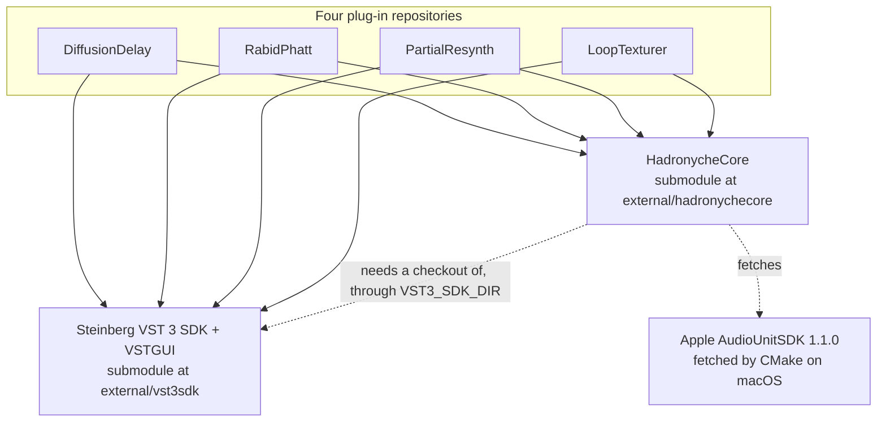

Each plug-in pins HadronycheCore twice: as the submodule, and as the commit of the reusable CI workflow `plugin-ci.yml` in its own `.github/workflows/ci.yml`. The two must move together, because the CI jobs run scripts from the submodule.

Size of the code, in lines, without the submodules:

| Repository | Rust | C++ in `src/` | C++ in `src/lv2/` | Core headers | Tests | Tools | CMake |
| --- | --- | --- | --- | --- | --- | --- | --- |
| HadronycheCore | 1989 | 1038 (gui + testhost) | 2146 | 1890 | 1005 | 4228 | 598 |
| DiffusionDelay | 827 | 213 | 43 | | 1263 | | 74 |
| RabidPhatt | 1041 | 249 | 54 | | 1814 | | 71 |
| PartialResynth | 1958 | 214 | 53 | | 1215 | | 75 |
| LoopTexturer | 3107 | 1234 | 373 | | 3043 | | 90 |

Three of the plug-ins have about 200 lines of C++ of their own. LoopTexturer has six times that, because it has a looper panel, an export and its own FFI. That difference is the most useful measure of what the frame does not yet cover (Part C).

#### What a plug-in produces

One source tree produces three plug-in formats and one installer per platform. The VST 3 component is the only thing the plug-in itself implements. The Audio Unit and the LV2 are wrappers around that component.

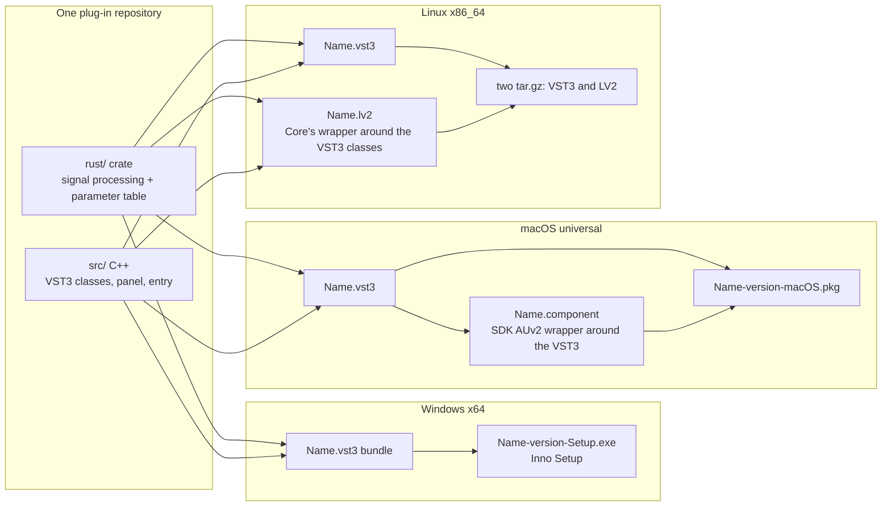

### A2. The layers

From the host down to the arithmetic, a running plug-in has five layers. Only one boundary crosses languages: the C ABI between `RustProcessor` and the Rust crate, defined in one file, `rust/hadronyche-plugin/src/ffi.rs`, and mirrored by the generated header `include/hadronyche/ffi/Plugin.h`.

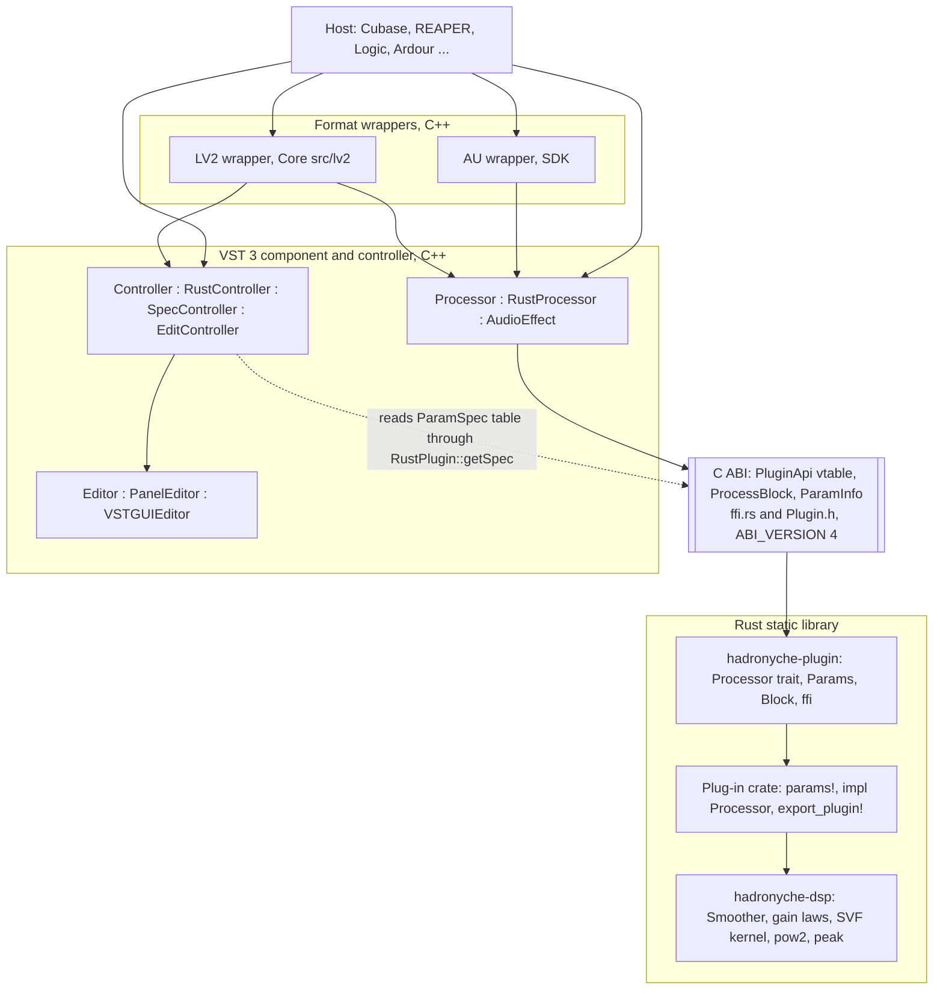

What crosses the boundary, and what does not:

| Crosses into Rust | Stays in C++ |
| --- | --- |
| The parameter table, read once at start (`param_spec`, `param_label`) | Everything a host sees: buses, class IDs, factory, sample size, state bytes layout |
| One normalized value per parameter per block, the last point of each change | Parameter text, `toString`/`fromString`, `IEditController` |
| Audio, stereo, 32-bit float, planar, one block at a time | The panel and all of VSTGUI |
| Transport: playing, tempo, project time in quarters, bar position, time signature | VST3 messages between processor and controller |
| Note on and note off events with sample offsets | LV2 ports, atoms, Turtle, UI |
| State bytes after the parameters (`save_state`, `load_state`) | The `ParamState.h` bytes before them |
| `shared()`: one opaque pointer for the plug-in's own C functions | The functions that read through that pointer |

### A3. The common anatomy of a plug-in

Every plug-in has the same tree. Files marked **B** are boilerplate, identical between plug-ins apart from the name and a few identity values. Files marked **P** hold the plug-in's own work.

```text
Name/
├── CMakeLists.txt                 B  version, AU codes, seven framework calls
├── .github/workflows/ci.yml       B  calls Core's plugin-ci.yml at a pinned commit
├── .gitmodules                    B  external/vst3sdk, external/hadronychecore
├── AGENTS.md, CLAUDE.md, README.md   shared structure, plug-in-specific rules
├── docs/signal-path.md            P  the behaviour specification
├── docs/release-notes/vX.Y.Z.md      one per release, becomes the GitHub release text
├── installer/Name.iss             B  Inno Setup script, only AppId differs
├── installer/NOTICE.txt           B
├── rust/
│   ├── Cargo.toml                 B  staticlib + lib, path deps into the submodule
│   ├── rustfmt.toml               B  max_width 120
│   └── src/lib.rs                 P  params! table, impl Processor, export_plugin!
│       └── *.rs                   P  the DSP modules
├── src/
│   ├── PluginConfig.h             B  name, vendor, two class FUIDs
│   ├── PluginEntry.cpp            B  one HADRONYCHE_PLUGIN_FACTORY line
│   ├── ParamIds.h                 G  generated by cargo test from params!
│   ├── Processor.h/.cpp           B  class Processor : RustProcessor, 34 lines
│   ├── Controller.h/.cpp          B  class Controller : RustController, 35 lines
│   ├── Editor.h/.cpp              P  buildPanel on PanelEditor
│   └── lv2/PluginInfo.cpp         P  LV2 URI, class, port symbols, flags
└── tests/
    ├── CMakeLists.txt, TestMain.cpp, Tests.h   B  test list and runner
    ├── Harness.h/.cpp             P  Plug on PlugBase, measurements
    ├── CompatibilityTests.cpp     P  hand-written IDs, ranges, state bytes
    ├── *Tests.cpp                 P  behaviour measured through the host interfaces
    └── PanelTest.cpp              P  Windows only, drives the real panel
```

The seven framework calls in `CMakeLists.txt`, in the order they must appear:

```cmake
set(CMAKE_OSX_DEPLOYMENT_TARGET "10.15" CACHE STRING "")   # before project(), decides which Macs the plug-in runs on
project(Name VERSION 1.4.0 LANGUAGES CXX)                  # CI refuses a tag that does not match this version
include("${HADRONYCHE_CORE_DIR}/cmake/HadronychePlugin.cmake")
hadronyche_use_vst3_sdk()          # macro: SDK options, fast-math off, static runtimes, then Core after the SDK
hadronyche_add_rust(Name)          # cargo build of rust/ into Name-rust; refuses a Core checkout that differs from the submodule
hadronyche_add_plugin(Name AU_TYPE aufx AU_SUBTYPE XXXX SOURCES ...)   # VST3 target, and the AU target on macOS
hadronyche_add_lv2(Name [LINKS src/lv2/Link.cpp])   # Linux: LV2 module from the VST3's own sources, plus the Turtle generator
add_subdirectory(tests)            # hadronyche_add_host_tests and hadronyche_add_lv2_tests inside
```

The C++ classes a plug-in writes are leaves of Core's classes. The diagram shows DiffusionDelay, the smallest case.

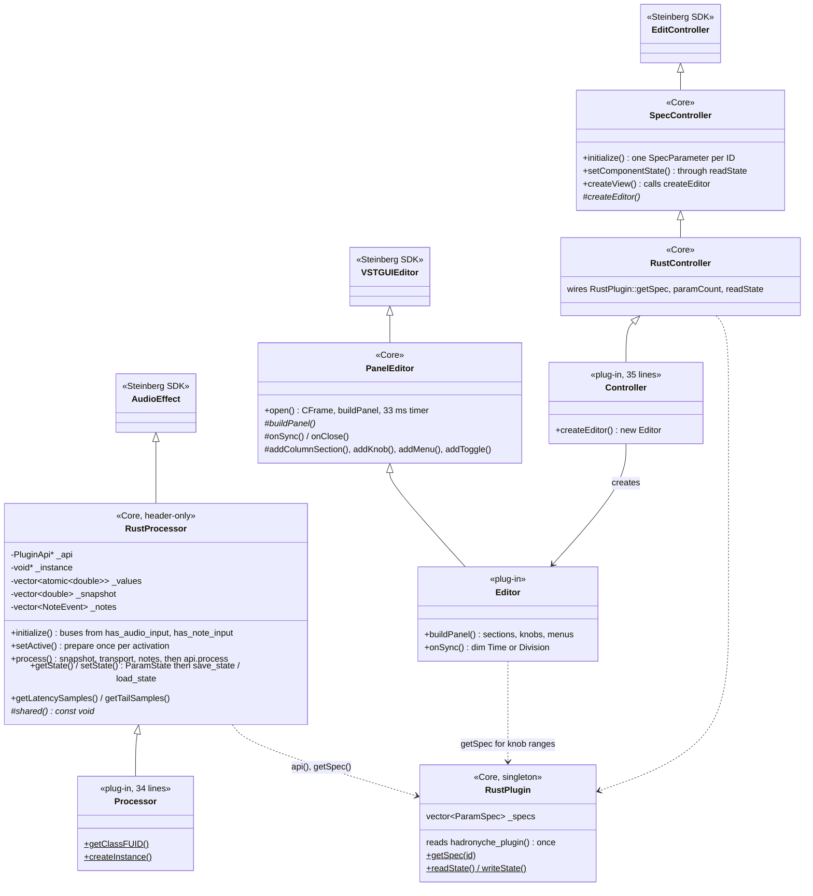

The entry point is one macro. `PluginEntry.cpp` reads, in full:

```cpp
#include "hadronyche/vst/PluginFactory.h"
HADRONYCHE_PLUGIN_FACTORY (DiffusionDelay, DIFFUSIONDELAY, Vst::PlugType::kFx, Vst::kDistributable)
```

It expands to the SDK's factory definition with two classes: the processor (`kVstAudioEffectClass`) and the controller (`kVstComponentControllerClass`), both `kManyInstances`, with the version string from `project()`. LoopTexturer passes `0` instead of `kDistributable`, because its controller finds the processor's memory through a registry, which needs both in one process.

### A4. HadronycheCore, the C++ side

#### Targets

Core is a set of CMake interface targets. A target with sources compiles them as part of whatever links it, so that they build with the plug-in's flags and runtime.

| Target | Needs | Holds |
| --- | --- | --- |
| `hadronyche_params` | nothing | `ParamSpec.h`: `ParamSpec`, `Curve`, `normalizedToPlain`, `plainToNormalized`, `kVolumeSilenceDb`. No SDK, so that a plug-in's tests can include its parameter IDs without linking it |
| `hadronyche_vst` | SDK | `RustPlugin.h`, `RustProcessor.h`, `RustController.h`, `SpecController.h`, `SpecParameter.h`, `ParamState.h`, `Denormals.h`, `PluginFactory.h`, and the generated `ffi/Plugin.h` |
| `hadronyche_gui` | SDK, VSTGUI | `PanelEditor.h/.cpp`, `PanelLayout.h` |
| `hadronyche_testhost` | SDK headers, `VST3_SDK_DIR` | `Host.h/.cpp`, `Signals.h`, `Runner.h`, `Panel.h` (Windows), `PanelOpens.h/.cpp` (Linux) |
| `Name-lv2`, `Name-lv2-turtle` | SDK, VSTGUI, lv2-dev, Linux | Built by `hadronyche_add_lv2` from `src/lv2/*.cpp` plus the plug-in's own VST3 sources |
| `Name-rust` | cargo | Built by `hadronyche_add_rust`: the crate's static library, with the native libraries rustc asks for |

#### The parameter model

A parameter is a `ParamSpec`: title, units, `min`, `max`, `defaultValue` (plain units), `curve`, `precision`, an optional list of labels, `isSilentAtMin` (the bottom of the range reads "-inf") and `isAutomatable`. The host stores every value normalized to 0..1. The curve decides the mapping.

| `Curve` | Value | Normalized to plain |
| --- | --- | --- |
| `Linear` | 0 | `min + n * (max - min)` |
| `Log` | 1 | `min * pow(max / min, n)` |
| `Squared` | 2 | `min + n * n * (max - min)` |
| `List` | 3 | `round(n * (labelCount - 1))` |
| `Toggle` | 4 | `n >= 0.5` |
| `Integer` | 5 | `round(min + n * (max - min))` |

The numbers are fixed. The Rust `Curve` enum in `param.rs` has the same ones, `Plugin.h` carries them, and `RustPlugin::toCurve` holds six `static_assert`s. The Rust `normalized_to_plain` repeats the C++ arithmetic, and both sides' tests pin the same hand-written values, so the processor and the controller agree to the last bit.

The table lives on the Rust side, in the plug-in's `params!` block. `RustPlugin` reads it once, at the first use of the singleton, and the three C++ readers take it from there:

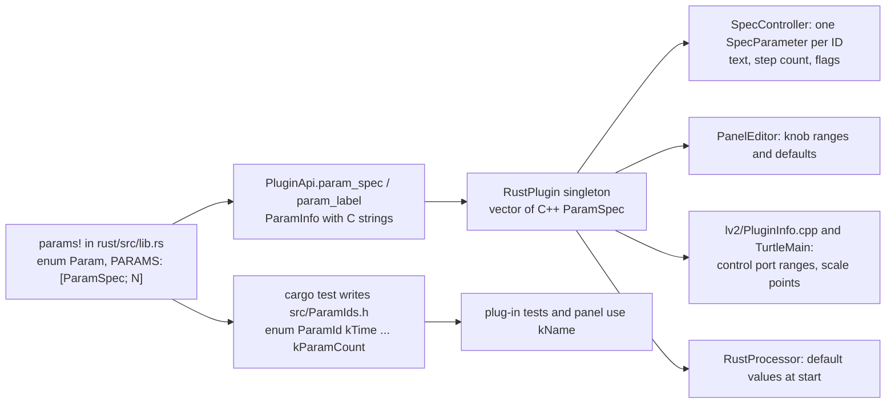

#### The saved state

`ParamState.h` writes the parameters. The Rust side can append its own bytes after them. The layout has not changed since the first release and must not.

```text
offset  size  field
0       4     int32  version     the plug-in's STATE_VERSION
4       4     int32  count       number of parameters
8       12    int32  id = 0, double normalized
20      12    int32  id = 1, double normalized
...                  one pair per parameter, in ID order
8+12N   ...   whatever Processor::save_state wrote (LoopTexturer: the loop)
```

Reading tolerates damage: a version of 0 or above the current one is refused, an unknown ID is skipped, a NaN or infinite value is skipped, a value outside 0..1 is clamped, and a stream that ends early fails after delivering what it had. Each value goes through the plug-in's `migrate_param(id, value, version)`, which lets a plug-in reinterpret a value saved by an older version. `load_state` must read an empty remainder as "nothing more", because a project saved before the plug-in appended anything ends at the parameters.

#### `RustProcessor`

`RustProcessor` is a header-only `AudioEffect` that decides everything a host sees and hands the Rust side only the block. Its decisions:

- Buses: one stereo output always, one stereo input when `has_audio_input`, one 16-channel event input named "MIDI In" when `has_note_input`. Any other arrangement is refused, and 32-bit samples only.
- Parameters: `std::vector<std::atomic<double>> _values`, written from the host's threads in `process` (`readChanges`) and in `setState`, read on the audio thread. Only the last point of each queue is kept, because smoothing is the Rust side's. Each block copies the atomics into a plain `_snapshot` vector and passes that.
- Activation: `setActive(true)` calls `prepare` with the sample rate, the maximum block size and the values as they stand. Once per activation, never earlier, because a plug-in can draw random starts there.
- Latency and tail ask Rust with `processSetup.sampleRate`, so that a host can ask before activation.
- Transport: five fields copied from `ProcessContext` with validity flags.
- Notes: note on and note off only, up to 1024 per block, into a pre-reserved vector.
- Denormals: `FlushDenormals` sets FTZ and DAZ on x86-64 and FZ on aarch64 for the duration of `process`.
- State: parameters first, then `save_state` or `load_state` over the host's `IBStream` through two static callbacks.

#### `PanelEditor`

`PanelEditor` is a `VSTGUIEditor` that builds a panel in code from sections, knobs, menus and toggles. There is no `.uidesc`. A plug-in provides `buildPanel()` and can override `onSync()` and `onClose()`. A control's tag is its parameter ID. A 33 ms timer pushes parameter values into the controls, and tags from `kParamCount` upwards are the plug-in's own buttons, which only its `valueChanged` handles. `PanelLayout` fixes the geometry (section height 112, knob 44, column 66, and so on) and `PanelTheme` the six colours. The panel tests click fixed positions, so the geometry is frozen.

On Linux the editor does three things VSTGUI does not do by itself: it opens the frame with a run loop in an `X11::FrameConfig`, it finishes Cairo's xcb device before VSTGUI disconnects, and the plug-in links with `-z nodelete` because Pango's font thread never ends.

#### The test host

`hadronyche_testhost` is a minimal VST 3 host for test programs. A test program loads the built plug-in binary and drives it through the SDK's interfaces, the way a host does, and links none of the plug-in's code, so that a test sees only what a host can. `PlugBase` creates the component and controller, connects them, sets up processing and activation, and offers `set`, `process`, `getStateBytes`, `setStateBytes`, `setTempo`. `Signals.h` has tones, noise, RMS, peak, dB and a windowed single-bin DFT. `Runner.h` turns a table of named tests into one program with `--list` and per-test invocation, which `hadronyche_add_host_tests` registers in CTest one by one. `Panel.h` (Windows) opens the real panel off-screen and sends mouse messages; `PanelOpens.cpp` (Linux) opens and closes the panel under Xvfb twenty times.

### A5. HadronycheCore, the Rust side

`rust/` is a Cargo workspace of three crates, edition 2024, Rust 1.85 or newer, with one formatting rule (120 columns) and the CI command line as the lint policy: `cargo fmt --check`, `cargo clippy --all-targets -- -D warnings`, `cargo test`.

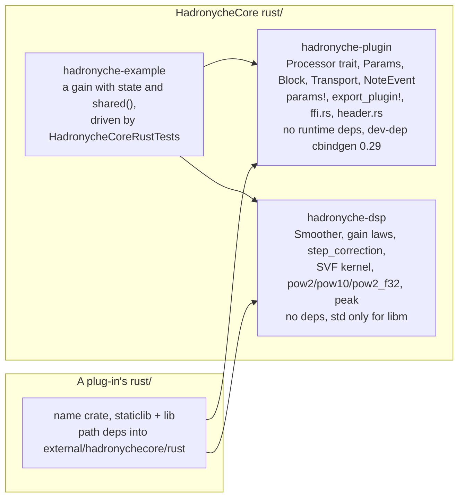

`hadronyche-plugin` and `hadronyche-dsp` do not depend on each other. A plug-in crate depends on both by path into its submodule. Cargo cannot redirect a path dependency, so the Rust side always builds from the submodule, and `hadronyche_add_rust` stops when a `HADRONYCHE_CORE_DIR` checkout differs from it, file by file.

#### The `Processor` trait

A plug-in implements this once, in `rust/src/lib.rs`. The frame calls each method from a known thread at a known time.

| Member | Called | Thread | Purpose |
| --- | --- | --- | --- |
| `const PARAMS: &[ParamSpec]` | once, at load | | The parameter table from `params!` |
| `const STATE_VERSION: i32 = 1` | | | Written into saved state. Raise it when a saved value has to be read differently |
| `const HAS_AUDIO_INPUT: bool` | | | Adds a stereo input bus |
| `const HAS_NOTE_INPUT: bool = false` | | | Adds an event input bus |
| `fn new() -> Self` | per instance | host | May allocate |
| `fn prepare(&mut self, sample_rate, max_block_size, params)` | once per activation | host | Sizes every buffer. Blocks are never longer than `max_block_size` |
| `fn process(&mut self, block) -> Output` | per block | audio | No allocation, lock or system call. Returns `Sound` or `Silence` |
| `fn latency(&self, sample_rate) -> u32` | any time, also before activation | host | Hence the sample rate argument |
| `fn tail(&self, sample_rate) -> Tail` | any time | host | `Samples(n)` or `Infinite` |
| `fn migrate_param(index, normalized, version) -> f64` | per saved value | host | Static. Reinterprets values from older `STATE_VERSION`s |
| `fn save_state(&self, &mut dyn StateWriter) -> bool` | on save, after the parameters | host | May allocate |
| `fn load_state(&mut self, params, &mut dyn StateReader) -> bool` | on load, after the parameters | host | An empty remainder must read as nothing |
| `fn shared(&self) -> *const c_void` | on demand | any | One pointer for the plug-in's own C functions. Null by default |

`Block` is the Rust view of one block: `params: Params` (the snapshot, with `normalized(id)`, `plain(id)`, `spec(id)`), `input: Option<[&[f32]; 2]>`, `output: [&mut [f32]; 2]`, `transport: &Transport`, `notes: &[NoteEvent]`. The input is never the output's memory, because `ffi.rs` copies it first.

`params!` generates a `#[repr(u32)]` enum whose order is the parameter ID order, `COUNT`, `NAMES` (for the generated header), an `impl ParamId`, and the `PARAMS` table. `ParamSpec` has `const fn` constructors: `new(title, units, min, max, default, curve, precision)`, `list(title, labels, default)`, `toggle(title, on)`, and the modifiers `silent_at_min()` and `not_automatable()`. Titles and labels are `&'static CStr`, because the C++ side reads them in place.

`export_plugin!(Type)` defines the one exported symbol:

```rust
#[unsafe(no_mangle)]
pub extern "C" fn hadronyche_plugin() -> *const PluginApi {
    static API: PluginApi = PluginApi::of::<Type>();
    &API
}
```

#### `hadronyche-dsp`

The shared arithmetic, with the reasons each item is the way it is. Every rule here came out of the null test against the C++ builds.

| Item | What | Why it is like this |
| --- | --- | --- |
| `Smoother` (`prepare`, `set_target`, `snap_to`, `step`, `step_f32`) | One-pole smoothing, f64 | In f32 it stalls about 0.01% short of its target, which leaves a glide out of tune and a free running loop the wrong length. `step_f32` casts the result, so an f32 signal path stays f32 |
| `db_to_gain`, `volume_to_gain`, `dry_gain`, `wet_gain`, `VOLUME_SILENCE_DB` | The gain laws | Dry and wet both play at full level at 50%, so nothing drops in the middle |
| `pow2`, `pow10`, `pow2_f32` | `black_box(2.0).powf(x)` | LLVM rewrites `pow(2, x)` as `exp2(x)`, and glibc rounds the two differently at a few inputs in a hundred thousand. Hiding the base keeps the call to `pow`, as the C++ had |
| `step_correction` | Integral of a cubic B-spline minus the ideal step | Band-limits a sawtooth's wrap. Reaches two samples each way and works to a quarter of the sample rate, so oscillators fade out by there |
| `SvfMode`, `svf_warp`, `svf_coefficients`, `svf_tick`, `svf_output` | Topology-preserving state-variable filter kernel | Stable under fast modulation. Plug-ins build filters with as many channels and stages as they need. `SvfMode` values are saved parameter values, so only ever add at the end |
| `peak` | Max absolute value over channels | NaN never wins, infinity does |

The crate uses `std` only for the float functions, which call the platform's maths library as the C++ did. A `no_std` crate needs `libm`, whose `exp`, `tan` and `pow` round differently, and the ports then stop being bit for bit.

### A6. The FFI boundary

One `#[repr(C)]` vtable, `PluginApi`, is all the C++ side knows about the Rust side. `ffi.rs` defines it and the generic functions behind it, and `cbindgen` writes `Plugin.h` from it in a `cargo test`. `ABI_VERSION` is 4 and goes up with any change to the structs or functions. `RustPlugin` refuses another version, and the plug-in then behaves as one without parameters and stays silent, which its tests see at once.

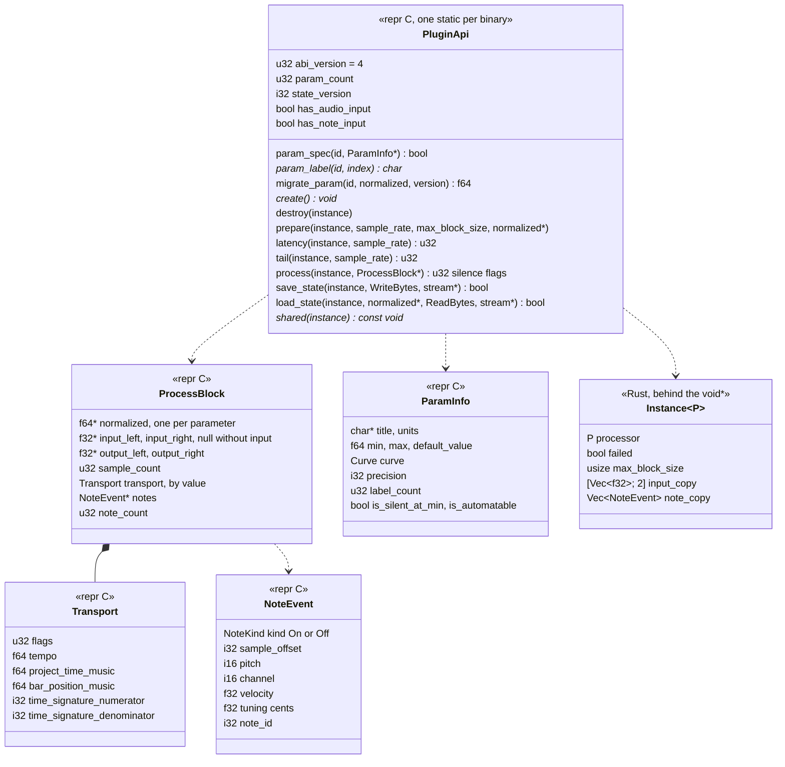

#### Lifecycle, as the host drives it

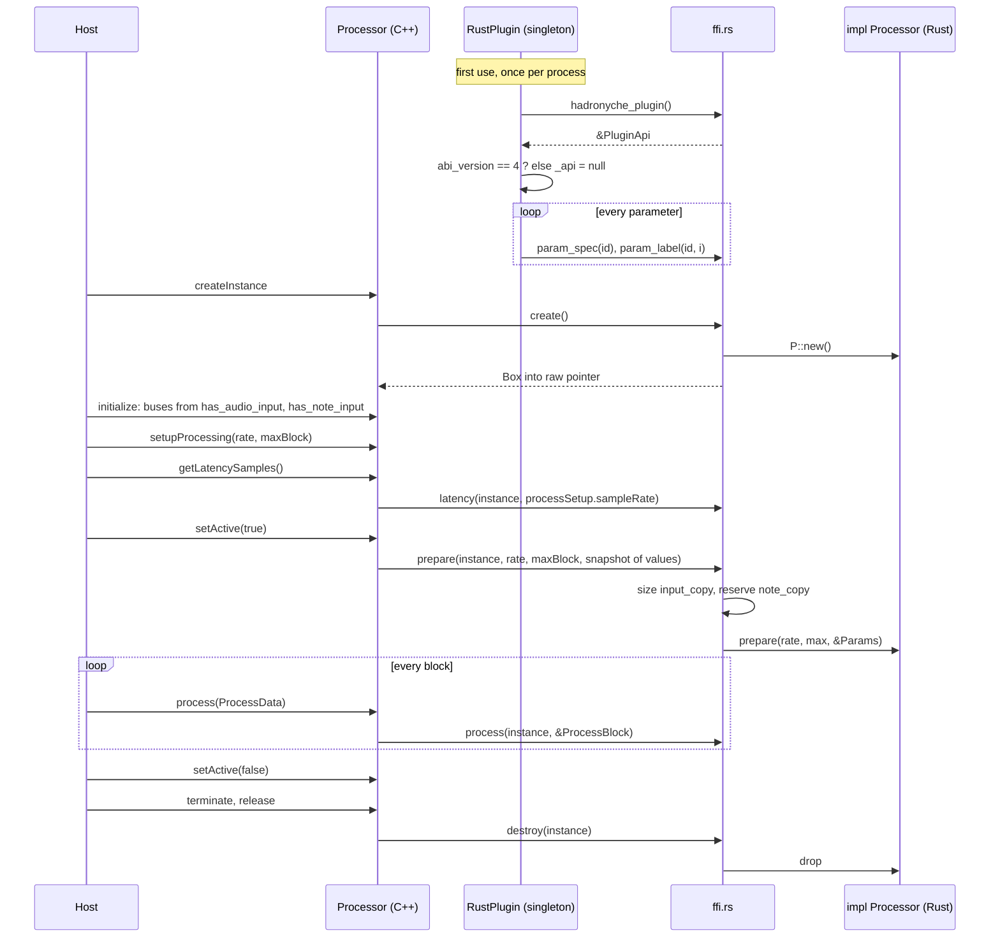

#### One block

The audio thread path. Three things happen in `ffi.rs` that a plug-in never has to think about: the input is copied so that the processor's two views never overlap even when the host's do, a block longer than `prepare` said is cut into pieces with the notes rebased per piece, and a panic is caught.

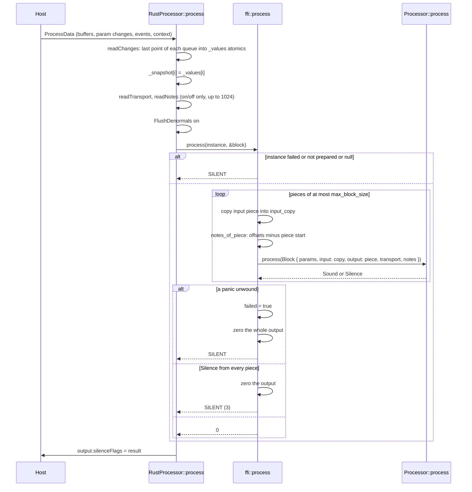

After a panic the instance stays silent for good and reports latency and tail 0, while `save_state` still answers true so that the project can be saved with its parameters. Other instances are unaffected. A panic is still a bug.

#### State

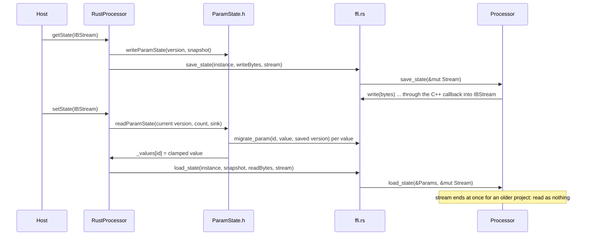

The order matters: the parameters are restored before `load_state`, so that a plug-in's extra state can depend on their values. LoopTexturer relies on this. With the order reversed, its audio thread can see the old looper mode, treat the change as a mode switch and clear the new loop.

#### Generated headers

Nothing in the build generates code. Two `cargo test`s check that the checked-in headers match the Rust side, and `HADRONYCHE_UPDATE_HEADERS=1 cargo test` rewrites them.

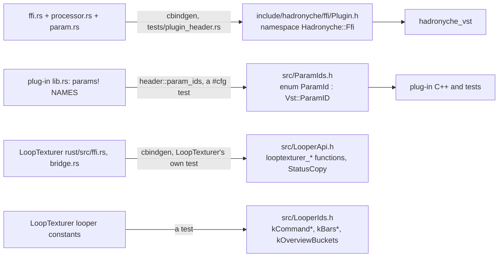

A stale header fails `cargo test` on CI, not the compile. An ABI mismatch between a built Rust library and the header shows only at run time, as a silent plug-in without parameters.

### A7. Threads and data at run time

A VST 3 plug-in sees three kinds of thread, and LoopTexturer adds a fourth. The frame's rule is that nothing on the audio thread allocates, locks or blocks, and the design below is what makes that possible.

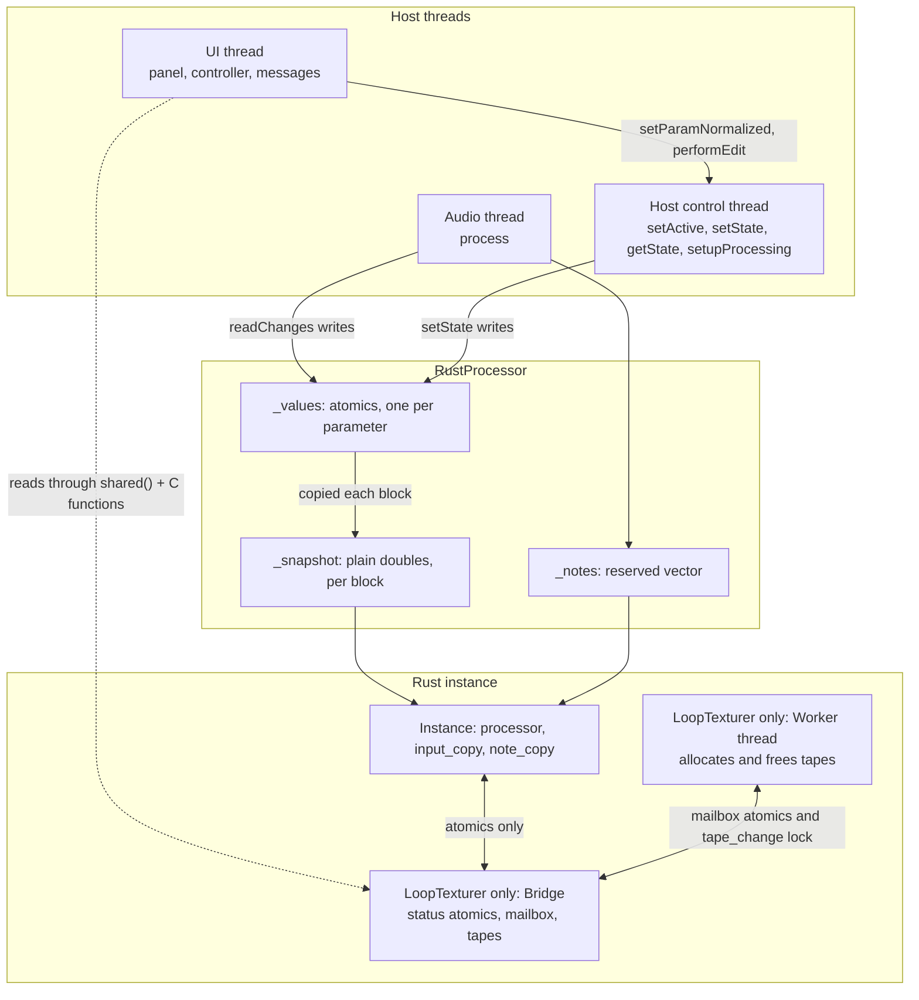

Parameter flow, end to end:

1. The host queues changes in `IParameterChanges` with sample offsets. `readChanges` keeps the last point per parameter and stores it in an atomic. The sample offsets are dropped.
2. `process` copies every atomic into `_snapshot` and hands the pointer to Rust as `normalized`.
3. `Params` wraps that slice. The processor reads `params.plain(Param::Time)` and sets a `Smoother` target. Smoothing, and the choice of control rate, is the processor's.
4. Off the audio thread, `prepare`, `setState` and `getState` build a fresh snapshot with an allocating `snapshot()`.

The consequence is that automation is per block, not per sample. A ramp inside one block arrives as its last value. Notes keep their sample offsets, and RabidPhatt renders the block in slices up to each note.

### A8. The formats: VST 3, Audio Unit, LV2

The plug-in implements VST 3. The other two formats host that VST 3 component in process.

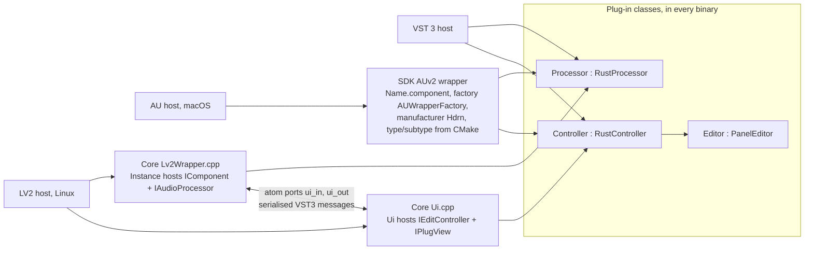

#### Audio Unit

`hadronyche_add_plugin` on macOS calls `hadronyche_add_audio_unit`, which configures `cmake/au-info.plist.in` and uses the SDK's `smtg_target_add_auv2`. The manufacturer code is fixed at `Hdrn`, the type and subtype come from the plug-in's `CMakeLists.txt` (`aufx`/`DfDl`, `aumu`/`RbPh`, `aufx`/`LpTx`, and so on), inputs are 0 for `aumu` and 2 otherwise. Hosts find a plug-in in saved projects by these codes. The `.pkg` installer ships the `.component` with a real copy of the VST3 inside, and `auval` validates it on CI.

#### LV2

`src/lv2/Lv2Wrapper.cpp` is a complete LV2 plug-in around the VST3 classes, built from the plug-in's own VST3 sources plus Core's five wrapper files. A plug-in adds `src/lv2/PluginInfo.cpp` with its URI, LV2 class, port symbols and flags. The port layout follows from the flags, in a fixed order, and the Turtle is generated by a small program at build time.

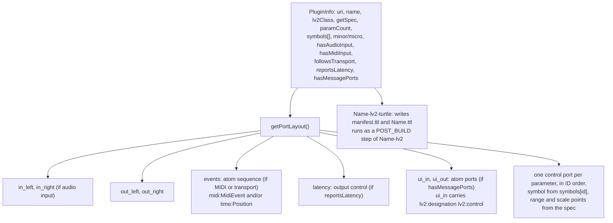

How the wrapper maps the two worlds:

| LV2 | VST3, inside the wrapper |
| --- | --- |
| `instantiate` with `urid:map`, `opts:options`, `bufsz:maxBlockLength` | `GetPluginFactory()`, `createInstance`, `initialize`, `setupProcessing`, activate buses, size every buffer |
| control port, one float per `run()` | an `IParamValueQueue` with one point at offset 0, only when the port changed and differs from what was applied |
| `midi:MidiEvent` in the events port | `Vst::Event` note on or off, `noteId` -1 |
| `time:Position` object | a `ProcessContext` synthesised and advanced by the wrapper (tempo 120, 4/4 until the host says otherwise) |
| state `save`/`restore` with one `atom:Chunk` property | `getState`/`setState` of the component, then the controls' "applied" values are reset from the restored state so that a port echoing a rounded value is not a change |
| latency port | `getLatencySamples()` written each block |
| `ui_in`/`ui_out` atoms | `IMessage`s serialised by `Message::toBytes`, carried through two single-producer ring buffers and a message thread |

Messages are where the LV2 differs most from the VST3. A VST3 host connects processor and controller in one process. An LV2 host can run the UI in another process, so the wrapper never shares memory and copies messages instead:

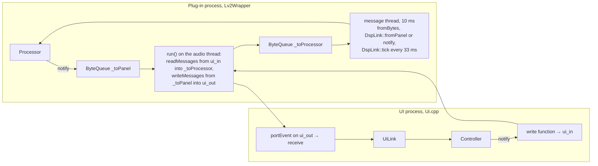

A plug-in can give `hadronyche_add_lv2` `LINKS` sources that define `createDspLink()` and `createUiLink()`. The defaults (`NoLinks.cpp`) return null and every message passes unchanged. LoopTexturer's `LooperLink.cpp` replaces the shared-memory bridge with copies of its status and waveform (Part B).

The LV2 UI side runs its own xcb connection and a process-wide `IRunLoop` serviced from the host's idle calls, because REAPER does not offer `ui:idleInterface` and calls idle anyway. A knob being edited ignores its port, because hosts echo what the UI wrote late enough to move the knob back under the mouse.

### A9. The build

Two CMake files in Core do the work: `cmake/HadronychePlugin.cmake` sets up the SDK and the plug-in targets, and `cmake/HadronycheRust.cmake` drives Cargo. The plug-in's own `CMakeLists.txt` is the seven calls of A3.

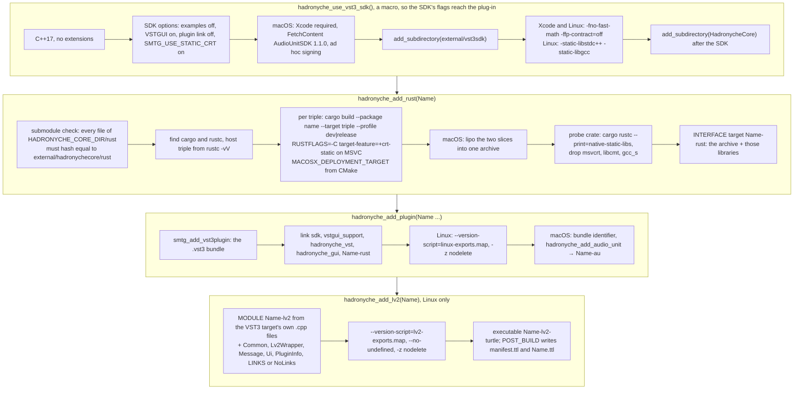

Points that matter when changing the build:

- `-ffast-math` stays off. With it the compiler can remove every `std::isfinite`, and on Apple Silicon `2 * (1 - 100 / 100)` comes out at about -4e-17, so fully wet effects leak a trace of dry signal. The tests failed on exactly this.
- The Rust library links with the plug-in's own C runtime. `crt-static` matches `SMTG_USE_STATIC_CRT`, and the runtime libraries are dropped from rustc's list because the plug-in's link already has them. Without the static runtime, a plug-in fails to load on a PC without Microsoft's runtime, and no test machine notices, because that runtime is on all of them.
- On macOS the Rust library is built for both architectures and joined with `lipo`, because Xcode builds universal and Rust has no universal target.
- Only three symbols leave a Linux VST3 (`GetPluginFactory`, `ModuleEntry`, `ModuleExit`) and two leave an LV2 (`lv2_descriptor`, `lv2ui_descriptor`). The tarball tests check this.
- A Linux release builds in an `ubuntu:22.04` container, because a binary needs a glibc as new as the one it was built against. The tarball test reads the highest `GLIBC_` version from the binary.

### A10. CI and release

Every plug-in's CI is one reusable workflow in Core, `plugin-ci.yml`, called with the plug-in's name and AU codes. Core's own `ci.yml` tests the library against the example crate.

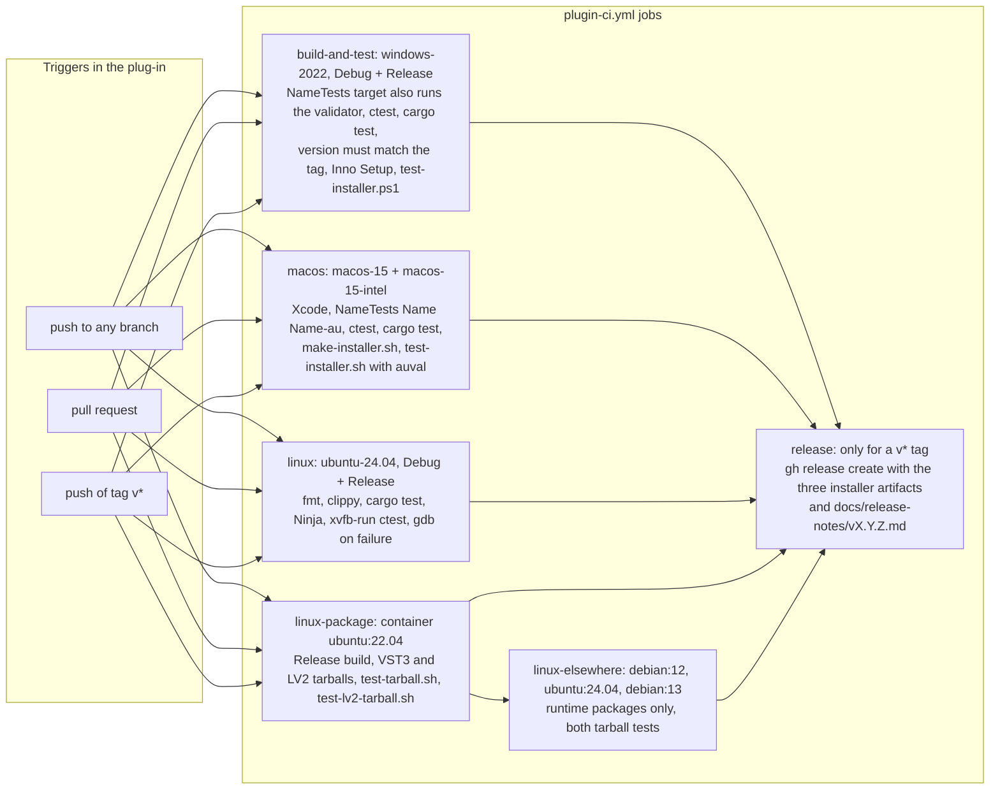

The release recipe, which produced the four releases of 2026-11-08:

1. Set the version in `project()` in `CMakeLists.txt`.
2. Add `docs/release-notes/v<version>.md`, which becomes the release text.
3. Merge to main through a pull request and wait for CI.
4. Push an annotated tag `v<version>` on that commit. The `release` job attaches `Name-<version>-Setup.exe`, `Name-<version>-macOS.pkg`, `Name-<version>-Linux-x86_64.tar.gz` and `Name-<version>-Linux-x86_64-LV2.tar.gz`.

A change in Core reaches a plug-in only when the plug-in moves its submodule and the commit in its `ci.yml` together. Core's `AGENTS.md` asks for the Core tests in Debug and Release, the plug-in's tests on the new version, a null test against the previous build, and a try in Cubase if possible.

### A11. Testing

Testing has six layers, from pure Rust to installed binaries. Each layer sees the plug-in the way one more kind of consumer does.

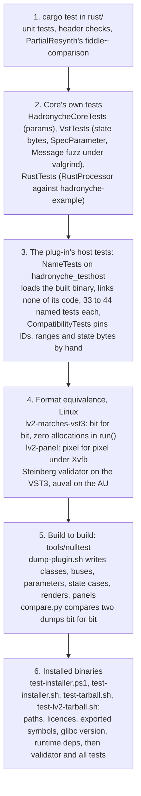

The null test is the tool that made the Rust port safe. It dumps everything a host can observe from one build, and the Rust builds were compared against the last C++ builds until every file matched. `compare.py --audio-tolerance -120` exists for a change that cannot be bit for bit, and says how far off it is.

Two facts about the host tests shape the plug-ins' designs:

- A test only sees what a host sees. There is no white-box access to the DSP, so each plug-in's tests are measurements: frequencies, levels, click detection, sample positions.
- `CompatibilityTests.cpp` holds hand-written values, and the rule is never to change one to make a test pass. A failure there means that the change damages saved projects.

### A12. The rules that shape everything

The `AGENTS.md` files hold the rules. Three groups define the architecture rather than the style.

**Saved projects.** Hosts store a parameter as its position in the table and its normalized value. So the `params!` order is append-only, ranges and curves of existing parameters are frozen, list labels are append-only, and the `ParamState.h` byte layout, the class IDs, the AU codes, the LV2 URI, the port symbols and the port order never change. A plug-in that must reinterpret a saved value bumps `STATE_VERSION` and converts in `migrate_param`, as LoopTexturer did for its loop length.

**The audio thread.** `RustProcessor::process`, `ffi::process`, `Processor::process` and everything they call allocate nothing, lock nothing and call nothing that can block. Buffers get their size in `prepare`. Large work is spread over blocks or handed to another thread. `lv2compare` counts allocations per thread and is the only automated check. A panic is caught at the boundary and silences the instance, which is a bug, not a feature.

**Bit identity.** Each plug-in's Rust is bit for bit the C++ it replaced. Arithmetic stays in its order, `f32` stays `f32`, a power of 2 or 10 goes through the `pow2`/`pow10` helpers, `Smoother` stays `f64`, float functions come from the platform's maths library, and fast-math and contraction stay off. A change in the sound is a change, not rounding, and the null test is how it shows.

---

## Part B: the four plug-ins

Each section gives the signal path, the Rust modules, the parameters in brief, what the plug-in adds to the common anatomy, and the owner's decisions that fix the design. The parameter tables are in each plug-in's `rust/src/lib.rs` and its `AGENTS.md` carries the full rules.

### B1. DiffusionDelay (1.4.0)

A stereo echo whose feedback loop holds a lossless eight-channel diffusion network. Diffusion adds early reflections before each repeat and a tail after it, scattered across the stereo image. At 100% feedback the repeats never end and dissolve into a diffused mass. Effect, audio input, no notes, no latency, infinite tail.

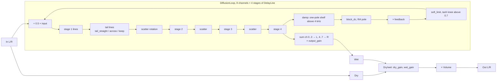

| Module | Holds |
| --- | --- |
| `lib.rs` | `params!` (8), `DiffusionDelay`: six `Smoother`s, tempo sync with 19 divisions, control rate 16 samples for Diffusion and Damper, a sleep check (`Output::Silence` once the input has been silent for the longest path), `Tail::Infinite` |
| `diffusion_loop.rs` | `DiffusionLoop`: `STAGE_SHARES` rows that sum to 1000, a skew-symmetric `SCATTER` matrix from the Paley construction mod 7, tails with prime shares, damper, DC blocker, `soft_limit`, `take_peak` |
| `delay_line.rs` | `DelayLine`: power-of-two buffer, glide towards a target length with linear interpolation while moving, whole-sample reads when still |

Parameters: Time (10 ms to 10 s, log), Feedback, Diffusion, Damper (dB), Dry/wet, Volume, Sync (Off/On), Division (19 entries). `STATE_VERSION` 1.

Own code beyond the anatomy: none in C++. `Editor::onSync` dims Time or Division by alpha according to Sync. The LV2 class is `DelayPlugin` with transport.

Owner's decisions fixed in `AGENTS.md`: everything between the network's input and output is lossless (delays and rotations only), nothing in the feedback path can exceed gain 1 at any frequency, 0% Diffusion is an exact clean delay, output never depends on block size, Time reaches 10 s with tempo sync, the damper is a shelf above about 4 kHz inside the loop.

### B2. RabidPhatt (1.5.0)

A monophonic synthesizer with 66 sawtooth oscillators: per side one on the note and 32 moving rows, which one Motion control pulls apart from the note and brings back. A sine LFO, free or tempo-synced, modulates Motion. Then an amplifier with an ADSR, a 24 dB per octave state-variable low-pass with its own ADSR, and Volume. Instrument, no audio input, note input, no latency, infinite tail.

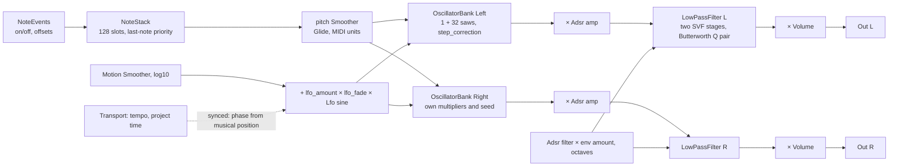

| Module | Holds |
| --- | --- |
| `lib.rs` | `params!` (19), `RabidPhatt`: note handling, block rendering in slices up to each note, LFO grid following, sleep when both envelopes idle and the peak is below 1e-6 |
| `note_stack.rs` | Fixed array of 128 notes, `note_on` removes a duplicate pitch and pushes, `note_off` closes the gap, `current_pitch` with tuning |
| `oscillator_bank.rs` | 32 multipliers per side, xorshift seeds `0x9E3779B9` and `0x85EBCA6B` for deterministic start phases, `saw` with `step_correction` and a fade between 0.2 and 0.25 of the sample rate |
| `adsr.rs` | Exponential stages, attack target 1.3 clamped to 1.0, release stops at 1e-4 |
| `lfo.rs` | Sine with delay and fade, `set_phase` for the grid |
| `low_pass_filter.rs` | Two cascaded `svf_tick` stages per channel, Q from 1.3066 to 20 |

Parameters: Motion (0.001 to 1, log), Glide, two ADSRs, Filter cutoff, resonance, env amount (octaves), Volume, LFO rate, amount, delay (squared), sync (toggle), division (16 entries). `STATE_VERSION` 1.

Notes across the boundary: `RustProcessor` flattens the host's `IEventList` into `NoteEvent`s with sample offsets. The processor renders `[position, offset)`, applies the note, and continues, so a note starts on its exact sample. A note-on with velocity 0 is a note-off. Velocity is otherwise unused, by design.

Own code beyond the anatomy: the `Editor` swaps the Rate knob and the Division menu through two `ViewGroup`s and adds `onClose`. The test `Harness` has a real `Plug` with an `IEventList` and note helpers. The LV2 class is `InstrumentPlugin` with MIDI and transport.

Owner's decisions: rows play `frequency × (1 + Motion × multiplier)`, the multipliers are the diagrams' values divided by 10 with one corrected typo, Motion is a log knob from 0.001, cancellation between rows and about 7 dB of self-beating are intended, the LFO is sine only, there is no velocity, there is never latency.

### B3. PartialResynth (1.4.0)

An effect that sums its input to mono, analyses it with a port of Pure Data's `fiddle~` peak analysis, keeps the five loudest spectral peaks, tracks them from frame to frame, and plays each with a two-oscillator voice through a filter, with the analysed amplitude as the only envelope. The dry signal is delayed by the reported latency and mixed back. Audio input, no notes, latency of three quarters of the window, tail of window plus latency.

```mermaid
flowchart LR
    In[In L/R] --> Mono["0.5 × (L + R)"]
    In --> DryD["dry_delay ring, latency_for(window) frames"]
    Mono --> A0["FiddleAnalyzer 0, offset 0"]
    Mono --> A1["FiddleAnalyzer 1, offset hop<br/>hop = window / 4, so a frame every quarter window"]
    A0 & A1 --> Tr["PartialTracker<br/>loudest five, continue within a semitone, fade, start new"]
    Tr --> V["5 × Voice<br/>Oscillator 1 + Oscillator 2 → StateVariableFilter → × amplitude ramp"]
    V --> Pan["constant-power pan at 0, -0.5, +0.5, -1, +1 × Spread"]
    Pan --> Mix[Dry/wet] 
    DryD --> Mix --> Vol[× Volume] --> Out[Out L/R]
```

| Module | Holds |
| --- | --- |
| `lib.rs` | `params!` (18), `PartialResynth`: window 2048/4096/8192 by sample rate, twelve smoothers, control rate 16, sleep with `skip_silence`, `latency`, `tail` |
| `fiddle_analyzer.rs` | A transliteration of `sigfiddle_doit`: spiral, FFT, half-band interpolation with the original's rounded constants, Hann power spectrum, peak picking by the "informal phase vocoder", up to 100 peaks |
| `partial_tracker.rs` | `Target`s for five voices: `choose_loudest`, `continue_partials`, fade marking, `start_partials` |
| `voice.rs` | Amplitude and pitch ramps over one hop, glide deferred for four frames on a new partial, key follow around 440 Hz, envelope to cutoff in octaves |
| `oscillator.rs` | Sine, saw, square with `step_correction` |
| `state_variable_filter.rs` | Mono SVF on Core's kernel |

Parameters: Threshold (dB), Glide (squared), two oscillators (wave list, level, coarse integer, fine), filter (mode list, cutoff log, resonance, key follow, env amount), Spread, Dry/wet, Volume. `STATE_VERSION` 1.

The reference test is the part worth knowing. `tests/reference/fiddle~.c` is Pd's file byte for byte. `rust/reference-fiddle` is a dev crate whose `build.rs` compiles it with `cc`, behind a stub `m_pd.h`, and `rust/tests/fiddle.rs` runs the port and the original on the same signals and requires identical frames and peak counts, frequencies within 0.005 and amplitudes within 5e-6. The original keeps its state in statics, so the wrapper holds a `Mutex` for the instance's life, because Cargo runs tests in parallel threads. The CMake project therefore declares `LANGUAGES C CXX`, and the installer ships `Pure-Data-LICENSE.txt` through the `extra_licenses` CI input.

Own code beyond the anatomy: none in C++. The LV2 class is `SpectralPlugin` with latency and without transport.

Owner's decisions: five partials with one voice each and one set of controls, two oscillators then a filter and no ADSR, the five loudest peaks rather than the lowest, a voice follows its partial rather than a list position, window 2048 with hop 512, the analyser is a port and not a design, so behaviour changes go in the tracker or the processor.

### B4. LoopTexturer (1.5.0)

An insert effect for sound design in Cubase: a chain of gain, pan with LFO, multimode filter with LFO and an oversampled saturator feeding a tape-style looper with a free running and a tempo-synced mode, a post saturator on the loop's output, dry/wet and volume. The loop is saved in the project, the panel draws the tape from shared memory, and on Windows and macOS the loop can be dragged onto the host's timeline as a WAV. Audio input, no notes, latency 96 samples always, infinite tail.

```mermaid
flowchart LR
    In[In L/R] --> Fin[finite_or_silence] --> Gain --> Pan["Pan + pan_lfo × amount"] --> SVF["StateVariableFilter<br/>pitch + filter_lfo × amount"] --> Sat["Saturator<br/>4× oversampled, 193 taps, 48 samples"]
    Sat --> DryD[dry delay 48 samples]
    Sat --> Loop["Looper::process_sample<br/>one head, one Tape"] --> Post["post Saturator<br/>48 samples"]
    DryD --> Mix[Dry/wet]
    Post --> Mix --> Vol[× Volume] --> Out[Out L/R]
```

This is the plug-in whose own code is largest, and the reason is not the chain but the looper's shared memory, its threads, its state and its panel. The structure:

```mermaid
flowchart TB
    subgraph rustside [Rust]
        LT["LoopTexturer (Processor)<br/>shared() = Arc::as_ptr(bridge)"]
        Looper["Looper<br/>head, modes, write_span, envelopes, sync grid"]
        Bridge["Bridge: id, Status atomics, Mailbox,<br/>requested frames, tape_change Mutex, tapes Vec of Arc"]
        Tape["Tape: cells as relaxed AtomicU32,<br/>32768 overview buckets min/max"]
        Worker["Worker thread, 50 ms<br/>allocates requested tapes, frees unused ones"]
        Reg["static REGISTRY: BTreeMap of id → Weak Bridge"]
        FFI2["ffi.rs: 16 looptexturer_* functions<br/>cbindgen → src/LooperApi.h"]
    end
    subgraph cppside [C++]
        Proc["Processor: connect() sends bridge id as a message,<br/>notify() forwards LooperCommand to the bridge"]
        Ctrl["Controller: notify() finds the bridge by id,<br/>sendLooperCommand()"]
        LB["LooperBridge.h: RAII over retained pointers,<br/>TapeView"]
        Ed["Editor: five buttons (tags 1000+), WaveformView,<br/>mode confirmation, drag start"]
        Exp["LoopExport.cpp: render_frames, render, WAV writer,<br/>CDropSource drag"]
        Link["lv2/LooperLink.cpp: DspLink copies status + overview chunks,<br/>UiLink builds a mirror bridge"]
    end
    LT --> Looper --> Bridge --> Tape
    Worker <--> Bridge
    Bridge --> Reg
    Bridge --> FFI2 --> LB --> Ed & Exp & Ctrl
    Proc -->|VST3 message: id| Ctrl
    Ctrl -->|VST3 message: command| Proc
    Link --> LB
```

| Module | Holds |
| --- | --- |
| `lib.rs` | `params!` (26), `STATE_VERSION` 3 with `migrate_param` for the loop length, `Worker`, `write_loop_state` and `read_loop_state`, `render_loop` for export, `get_transport` |
| `looper.rs` | One tape, one head. Free mode: a 30 s tape, the Length knob sets head speed, so changing it repitches. Sync mode: a tape for 64 bars plus 25% allocated by the worker, `Empty` → `Recording` → `Loop`, head computed from the host's musical position. `write_span` fills every cell the head passed, skips writing when nothing changes so 100% feedback stays bit-exact, keeps overview min/max per bucket |
| `tape.rs` | Samples as relaxed atomics so the UI reads while the audio thread writes, `read` averages up to 64 cells when playing faster than recorded |
| `bridge.rs` | `Status` and `StatusCopy` (repr C), `Mailbox` (pending commands, offered tapes, incoming load, active tapes), `LoadedLoop`, the registry of weak pointers |
| `ffi.rs` | The C functions: find, retain, release, create_mirror, status, send_command, active_tape, set_status, set_overview, tape capacity, bucket frames, overview, render_frames, render |
| `saturator.rs` | 4× oversampler with a Kaiser window of 193 taps (4n + 1 keeps the latency whole), six shapes, DC blocker |
| `lfo.rs`, `state_variable_filter.rs` | Four LFO waves with slew, stereo SVF |

Threads and what crosses them:

| Thread | Runs | Crosses by |
| --- | --- | --- |
| Audio | `process` → `Looper::begin_block`, `process_sample`, `end_block` | Atomics only: commands swapped out of the mailbox, offered tapes adopted, status published |
| UI | `Editor::onSync` on the 33 ms timer, `WaveformView::draw`, `exportLoop` | Reads the bridge through `LooperApi.h`, sends commands as VST3 messages |
| Host | `setState`, `getState`, `setActive` | `prepare` and `load_state` take the `tape_change` lock, hand a boxed `LoadedLoop` through the mailbox |
| Worker | Allocates and frees tapes | `requested_*_frames`, `offered_*_tape`, `tapes_in_use()`, `tape_change` |
| LV2 message thread | `DspLink::tick` 30 times a second, `UiLink::fromDsp` | Copies of `StatusCopy` and changed overview chunks, buttons back as the same `LooperCommand` message |

Why the bridge is found by ID: the processor sends only the bridge's ID in a VST3 message, and the controller looks it up in the registry of weak pointers. This avoids a dangling pointer whatever order the host destroys things in. It relies on processor and controller living in one process, so the factory flag is `0` and not `kDistributable`. The LV2 cannot rely on that, so `LooperLink.cpp` intercepts the ID message on the audio side and sends the panel copies instead, and the panel builds a mirror bridge with one frame per overview bucket and introduces it to the unchanged `Controller` with the processor's own message.

Saved state after the parameters: `i32` has-loop flag, then `i32` mode, `i64` frames, four `f64`s (quarters, anchor, frames per quarter, write speed), then all left and all right samples as `f32`. Version 3 kept the layout and widened the loop length from 10 s to 30 s, converted in `migrate_param`.

Owner's decisions: the post saturator processes only the loop's output and feedback never passes through it, feedback reaches 200% on every pass, Rec moves on to overdubbing in both modes, switching mode clears the loop after confirmation and the mode parameter is not automatable, the buttons are VST3 messages and not parameters, there is no dragging on Linux, the dragged WAV is the loop as heard, exported WAVs are never deleted, saturators add constant latency.

---

## Part C: towards a framework

This part is the starting point for the next discussion. It records what the frame covers today, what each plug-in still does on its own, the limits of the boundary, and the duplication that a framework absorbs. It lists candidate directions with their trade-offs, and it does not choose between them.

### C1. What Core covers, and what each plug-in still does

```mermaid
flowchart LR
    subgraph core ["HadronycheCore covers"]
        c1[VST3 component and controller frame]
        c2[Parameter model, curves, text, saved bytes]
        c3[FFI, panic safety, in-place copy, block splitting]
        c4[Panel builder: sections, knobs, menus, toggles]
        c5[AU wrapper setup, LV2 wrapper and UI, Turtle]
        c6[Build: SDK, Cargo, universal, static runtimes, exports]
        c7[CI, installers, tarballs, their tests]
        c8[Test host, signals, runner, null test, lv2compare, lv2panel]
        c9[Shared DSP: Smoother, gains, SVF kernel, pow helpers]
    end
    subgraph plug ["Every plug-in still writes"]
        p1["PluginConfig.h: two FUIDs"]
        p2["PluginEntry.cpp: one macro line"]
        p3["Processor and Controller: 70 lines of class shells"]
        p4["Editor: buildPanel, in C++ and VSTGUI"]
        p5["lv2/PluginInfo.cpp: URI, class, symbols, flags"]
        p6["ParamIds.h: generated, checked in"]
        p7["Tests: Harness, CompatibilityTests, behaviour tests, PanelTest"]
        p8["CMakeLists.txt, ci.yml, .iss: same template, different identity values"]
        p9["AGENTS.md, README.md, release notes"]
    end
    subgraph lt ["LoopTexturer alone writes"]
        l1["Its own C functions and cbindgen header"]
        l2["VST3 messages in Processor and Controller"]
        l3["Custom views, buttons with own tags, drag export"]
        l4["A worker thread and shared-memory bridge"]
        l5["Non-default state after the parameters"]
        l6["An LV2 link that mirrors its memory as messages"]
    end
```

The identity values that must be stable per plug-in, and where each lives today:

| Identity | Where | Consumer |
| --- | --- | --- |
| Processor and controller class IDs | `src/PluginConfig.h` | VST3 hosts, through the factory |
| AU type and subtype | `CMakeLists.txt`, `ci.yml` | AU hosts |
| AU manufacturer `Hdrn` | Core `cmake/HadronychePlugin.cmake` | AU hosts |
| LV2 URI, UI URI, port symbols | `src/lv2/PluginInfo.cpp` | LV2 hosts |
| Inno Setup `AppId` | `installer/Name.iss` | Windows upgrades |
| Bundle identifiers | derived from the name in Core's CMake | macOS |
| Parameter IDs | `params!` order | every host, automation, state |
| `STATE_VERSION` | `impl Processor` | `ParamState.h`, `migrate_param` |
| Version | `project()` | installers, tags, Turtle minor/micro are separate in `PluginInfo` |

### C2. What the boundary carries, and what it cannot

The `PluginApi` is deliberately small. These are the things a Rust processor cannot do today because nothing in the vtable carries them. Each is a design choice from the port, where the goal was a line-for-line move with no change in what a host sees.

| Area | Today | What is missing |
| --- | --- | --- |
| Buses | One stereo output, one optional stereo input, one optional 16-channel event input | Mono, sidechain, more buses, bus activation, surround |
| Sample format | 32-bit float, planar | 64-bit processing (`kSample64`) |
| Automation | Last value per block per parameter | Sample-accurate changes, ramps inside a block |
| Events | Note on and off with offset, pitch, channel, velocity, tuning, note ID | CC, pitch bend, aftertouch, note expression, program change, sysex, any event output |
| Transport | Playing, tempo, project time in quarters, bar position, time signature | Sample position, cycle range, system time, SMPTE, chord and scale |
| Parameters from Rust | None | Output parameters (meters), value changes from the processor, restart requests, groups, program lists, a bypass flag |
| Controller side | All C++: `SpecParameter` text, `SpecController`, `setComponentState` | Rust text formatting, Rust controller state, Rust-defined parameter text that differs from the spec |
| Messages | None in the vtable. LoopTexturer builds its own C functions over `shared()` | A generic processor-to-controller channel, or a generic status snapshot |
| Panel | `PanelEditor` in C++ with VSTGUI | Any Rust involvement in the UI, custom views, declarative layout |
| Threads | A plug-in starts its own `std::thread` | A frame-provided background worker, a frame-provided lock-free mailbox |
| Reset | `prepare` once per activation | A `setProcessing` or reset hook, flush on stop |
| Diagnostics | Panics are caught and discarded | Logging across the boundary, a panic message, a failure report to the host |
| Real-time safety | Convention, checked only by `lv2compare`'s allocation count | A compile-time or test-time guarantee |

The hard-coded stereo and 32-bit choice runs through four places at once: `RustProcessor`, `ProcessBlock`, the LV2 wrapper's `kStereo` and `au-info.plist.in`. Widening it is a change to all four and to `ABI_VERSION`.

### C3. Duplication and seams

Facts found while reading, listed without judgement. They are the places where a framework either absorbs code or makes a rule explicit.

**Repeated in every plug-in, differing by identity values only.** `CMakeLists.txt`, `ci.yml`, the `.iss` script, `NOTICE.txt`, `PluginConfig.h`, `PluginEntry.cpp`, `Processor.h/.cpp`, `Controller.h/.cpp`, `tests/TestMain.cpp`, `tests/CMakeLists.txt`, the skeleton of `CompatibilityTests.cpp` and `PanelTest.cpp`, the `rust/Cargo.toml` profile settings, the three standard `#[cfg(test)]` tests in `lib.rs`, and the structure of `AGENTS.md`, `README.md` and the release notes. A generator or a template repository produces all of it from a name, two FUIDs, the AU codes, an `AppId` and a URI.

**The same facts stated twice.** `PluginInfo` repeats `hasAudioInput` and `hasMidiInput`, which the vtable already reports as `has_audio_input` and `has_note_input`, and `paramCount` and `getSpec`, which `RustPlugin` already provides. `SpecController` still takes a `SpecGetter` and a `ParamStateReader`, a shape from when a C++ table existed, and `RustController` only wires `RustPlugin` in. `hadronyche_add_lv2` still looks for an optional `src/Parameters.cpp` for the Turtle generator, which no plug-in has any more. `PluginInfo`'s LV2 minor and micro versions are separate from `project()`'s version.

**Plug-in knowledge inside shared tools.** `tools/nulltest/main.cpp` knows LoopTexturer's `LooperCommand` message and its parameter titles. `lv2compare`'s `transport-synced` scenario keys on titles containing `"ync"`, `"LFO amount"` and `"Feedback"`, and `change-with-note` uses a fixed control index. `lv2compare` and `TurtleMain` carry the same hard-coded unit map and the "Volume" exception.

**Minimal host scaffolding written four times.** `Host.cpp`, `nulltest/main.cpp`, `lv2compare/main.cpp` and `Lv2Wrapper.cpp` each implement their own `IHostApplication`, `IParamValueQueue`, `IParameterChanges`, `IEventList`, and three of them their own random generator, signal makers and damaged-state builder.

**Generated code, checked in, checked by tests.** `Plugin.h`, `ExampleParamIds.h`, each `ParamIds.h`, `LooperApi.h` and `LooperIds.h` are written by `cargo test` and compared on CI. An ABI mismatch between a Rust library and the header shows only at run time.

**Lifetime by convention.** `SpecParameter` holds a `const ParamSpec&` into `RustPlugin`'s singleton vectors. `PanelEditor` holds a `const PanelTheme&`. `ffi.rs` assumes one caller at a time per instance (`Processor: Send`, not `Sync`), which the VST3 contract gives but nothing checks.

**Platform special cases spread out.** Linux: run loop in `X11::FrameConfig`, Cairo device finished by hand, `-z nodelete`, Wayland refused, `ModuleEntry(nullptr)`. macOS: `lipo`, AU wrapper, deployment target before `project()`. Windows: static CRT in two places, `crt-static` in `RUSTFLAGS`, the `panel` test. Each has a test that catches its removal, and each is a line in `AGENTS.md`.

**Where plug-ins differ in the same role.** The two division tables run in opposite orders (DiffusionDelay shortest first with "D"/"T" suffixes, RabidPhatt longest first with "dotted"/"triplet"), both frozen by position. The LV2 classes are `DelayPlugin`, `InstrumentPlugin`, `SpectralPlugin`, `DelayPlugin`. Three plug-ins report an infinite tail, PartialResynth a finite one. Three use `kDistributable`, LoopTexturer `0`.

### C4. Candidate directions

Each item is one way for the frame to grow towards "a framework for Rust audio plug-ins on three platforms". They are independent and listed from the least to the most invasive. Each has a cost in the saved-project rules of A12, which is why none is recommended here on its own.

1. **A plug-in template or generator.** One command produces the boilerplate of C1 from the identity values. No change to any shipped plug-in. The cost is a template to keep in step with Core, which is the same cost the four copies have today.

2. **Move the identity into one place.** A plug-in declares its FUIDs, AU codes, LV2 URI and symbols, and `AppId` in one file, and Core's CMake and C++ read it. `PluginInfo`'s repeated fields go. The port symbols can derive from `params!` names if the derived names equal today's symbols. That needs a check per plug-in, because symbols are saved in hosts' projects.

3. **A generic status and message channel in the vtable.** LoopTexturer's `shared()` plus sixteen C functions is the pattern that a second plug-in with a panel that shows live state repeats. A frame-level `status(instance, buffer)` snapshot and a `command(instance, id, payload)` call, both lock-free, cover the common case and leave the waveform's tape to the plug-in. This raises `ABI_VERSION` and adds a `Processor` method with a default.

4. **A frame-provided worker and mailbox.** LoopTexturer's `Worker` and `Mailbox` are the general shape of "allocate off the audio thread, hand over by atomic". As library types in `hadronyche-plugin`, they are tested once.

5. **Widen the block.** Sample-accurate parameter changes, more event kinds, and the missing transport fields are additive `ProcessBlock` fields with a new `ABI_VERSION`. Sample-accurate changes also need a decision about smoothing, which is the processor's today. Bus layout and 64-bit are larger, because four components agree on stereo float today.

6. **Declarative panels.** `buildPanel` is already a list of sections, knobs, menus and toggles. A description of the panel, from Rust or from data, rendered by `PanelEditor`, makes three of the four editors data. LoopTexturer's waveform and buttons remain custom. The panel tests click fixed positions, so the geometry must survive.

7. **Parameter text in Rust.** `SpecParameter::toString` and `fromString` call Rust, and the controller side becomes a pure shell. This needs bit-identical text, which the null test's `parameters.txt` checks.

8. **The controller in Rust.** The farthest step: an `IEditController` frame in Rust, with C++ only as the VST3 entry. The class IDs, state format and editors stay, so saved projects are safe, but the test discipline needs a Rust-side host test. The all-Rust route with `nih-plug` or `vst3-sys` was rejected in the port's plan because it breaks class IDs, state format, the editors and the tests.

Whatever the direction, two tools decide whether a step is safe: the null test for everything a host can observe, and `lv2compare` for the LV2. Both exist, and both were enough for the port.

---

## Appendix: file index

### HadronycheCore

| Path | Purpose |
| --- | --- |
| `include/hadronyche/vst/ParamSpec.h` | Parameter description, curves, conversions |
| `include/hadronyche/vst/ParamState.h` | Saved parameter bytes |
| `include/hadronyche/vst/SpecParameter.h`, `SpecController.h` | VST3 parameter and controller on a spec table |
| `include/hadronyche/vst/RustPlugin.h` | Singleton reading the Rust vtable and table |
| `include/hadronyche/vst/RustProcessor.h` | The audio component frame |
| `include/hadronyche/vst/RustController.h` | The controller frame |
| `include/hadronyche/vst/Denormals.h` | `FlushDenormals` |
| `include/hadronyche/vst/PluginFactory.h` | `HADRONYCHE_PLUGIN_FACTORY` |
| `include/hadronyche/ffi/Plugin.h` | Generated C++ view of `ffi.rs` |
| `include/hadronyche/gui/PanelEditor.h`, `src/gui/PanelEditor.cpp`, `PanelLayout.h` | The panel builder |
| `include/hadronyche/lv2/PluginInfo.h`, `Message.h`, `MessageLink.h` | LV2 description, serialised messages, link hooks |
| `src/lv2/Lv2Wrapper.cpp`, `Ui.cpp`, `Common.*`, `Message.cpp`, `MessageAtoms.h`, `ByteQueue.h`, `NoLinks.cpp`, `TurtleMain.cpp` | The LV2 wrapper |
| `include/hadronyche/testhost/*`, `src/testhost/*` | The test host |
| `rust/hadronyche-plugin/src/{lib,param,processor,ffi,header}.rs` | The Rust frame |
| `rust/hadronyche-dsp/src/{smoother,gain,power,step,svf,lib}.rs` | Shared DSP |
| `rust/hadronyche-example/src/lib.rs` | The example plug-in for Core's tests |
| `cmake/HadronychePlugin.cmake`, `HadronycheRust.cmake`, `*.map`, `au-info.plist.in` | The build |
| `tests/*` | Core's tests |
| `tools/nulltest`, `tools/lv2compare`, `tools/lv2panel`, `tools/{linux,macos,windows}` | Comparison tools and installer scripts |
| `.github/workflows/ci.yml`, `plugin-ci.yml` | Core's CI and every plug-in's CI |

### Each plug-in

| Path | Purpose |
| --- | --- |
| `rust/src/lib.rs` | `params!`, `impl Processor`, `export_plugin!` |
| `rust/src/*.rs` | DSP modules (B1 to B4) |
| `src/PluginConfig.h`, `PluginEntry.cpp` | Identity and factory |
| `src/ParamIds.h` | Generated parameter IDs |
| `src/Processor.*`, `Controller.*`, `Editor.*` | VST3 classes and panel |
| `src/lv2/PluginInfo.cpp` | LV2 identity |
| `tests/*` | Host tests |
| `docs/signal-path.md` | Behaviour specification with Requirement and Proposed markers |
| `installer/Name.iss`, `NOTICE.txt` | Windows installer |

LoopTexturer adds `src/LooperApi.h`, `LooperIds.h`, `LooperBridge.h`, `Messages.h`, `LoopExport.*`, `src/lv2/LooperLink.cpp`, `rust/cbindgen.toml`, `rust/src/{bridge,ffi,looper,tape}.rs` and `tests/lv2/LooperLv2Test.cpp`. PartialResynth adds `rust/reference-fiddle`, `rust/tests/fiddle.rs`, `tests/reference/*` and `licenses/pure-data.txt`.

### Glossary

| Term | Meaning here |
| --- | --- |
| Frame | The part of Core that a plug-in's Rust processor fits into: the `Processor` trait, `ffi.rs`, `RustProcessor`, `RustController` |
| Normalized value | A parameter value in 0..1, as hosts store it. The curve maps it to plain units |
| Plain value | A parameter value in its own units: ms, dB, Hz, a list index |
| Block | One call of `process`: a run of samples with the parameter snapshot, transport and notes of that moment |
| Null test | Comparing two builds' observable output bit for bit with `tools/nulltest` |
| Bridge | LoopTexturer's shared-memory object between its audio side and its panel |
| Mirror | The LV2 panel's stand-in bridge, filled from message copies |
| Turtle | The `.ttl` files that describe an LV2 plug-in to its host |
| Submodule pin | The commit of HadronycheCore a plug-in builds against, in `.gitmodules` and `ci.yml` |
